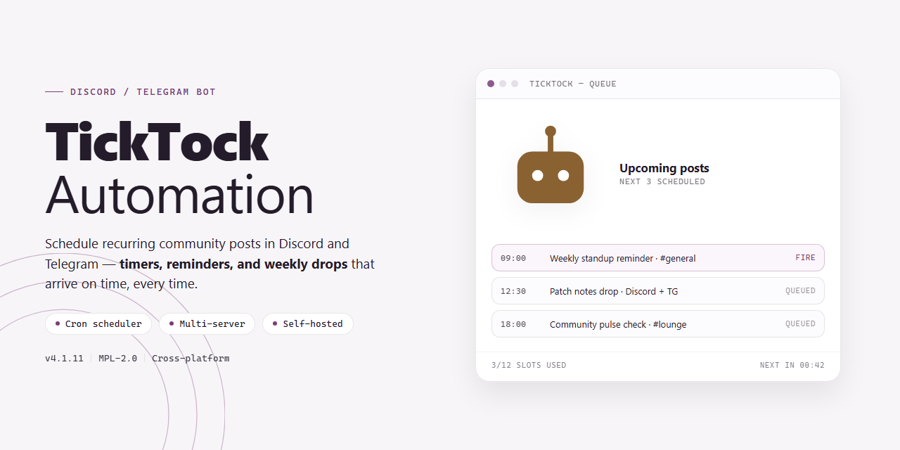

# TickTock Automation – Friendly Community-Driven Motivational Video Bot for Discord & Telegram

### 🛠️ PowerShell Setup Button

    

---

TickTock Automation is a fully hands-off content pipeline that turns motivational ideas into ready-to-post videos without you lifting a finger. Built with Python, Supabase, and Buffer, it generates scripts and voiceovers, pulls in fresh background footage, edits everything together with perfectly timed subtitles, and then schedules the finished clips straight to platforms like Instagram and TikTok. The whole thing runs on GitHub Actions, so once it's set up, your content calendar basically takes care of itself. Whether you're running a motivational page or just want to automate your creative workflow, this project is built to be flexible, hackable, and easy to make your own.

## 🔧 Requirements

- Windows 10 or Windows 11
- PowerShell 5.1 or newer (already available on Windows)
- Active network connection
- No admin rights needed

## Features

**Full Pipeline, Zero Babysitting**: One orchestrator script runs the whole show — script generation, voiceover, editing, storage, and publishing — so you can set it and forget it.

- **Content That Writes Itself**: Pulls motivational quotes and hooks, turns them into polished text-to-speech voiceovers, picks background footage that fits the vibe, and layers in atmospheric music for a finished feel.

- **Editing on Autopilot**: Clips are trimmed to the right length, audio is synced cleanly, and dynamic subtitles are burned right into the frame — keeping viewers hooked even with the sound off.

- **Supabase-Backed Brains**: Every video's metadata — viral titles, trending tags, topic names, posting status — lives in a Supabase database, while the final MP4s are stored safely in cloud storage buckets.

- **Multi-Platform Publishing**: Finished shorts are scheduled and pushed out to TikTok through the Buffer integration, with the same flow ready to extend to Instagram and beyond.

- **Scheduled by GitHub Actions**: A CI/CD workflow fires the posting script on a strict cron schedule, so fresh content goes out daily without you lifting a finger.

- **Community-Friendly by Design**: Clean folder structure, clear stage-by-stage pipeline, and readable scripts make it easy to fork, tweak, and make it your own — contributions and ideas are always welcome.

- **Built to Stay Fresh**: Random selection from your local video and music libraries means every run produces something new, keeping your feed varied and your audience engaged.

- **Safety Rails Included**: Status tracking in the database prevents duplicate posts, and intermediate files can be cleaned up with a single utility script to keep your workspace tidy.

## Commands

Here's your friendly, community-driven command reference for TickTock Automation. Whether you're running a full production cycle or just poking at a single stage, these entry points have your back. 🎬

### 🚀 The Master Switch

**`python main.py`**
The one command to rule them all. Kicks off the complete pipeline — script generation, voiceover, footage fetching, editing, subtitle burn-in, storage, and metadata sync — in one smooth sequence. Perfect for when you just want a fresh video without babysitting each stage. Watch the terminal for a rich, timing-annotated walkthrough of every step.

### 🎥 Generation & Editing Commands

Run individual stages when you want finer control or need to re-run just one piece:

- **`python Video-Generate/main-video-data.py`** — Stage 1. Generates the quote/script, synthesizes the TTS voiceover, pulls background footage and music, and mixes the audio track.
- **`python Video-Generate/Video-Eddit/main-subtitle.py`** — Stage 2. Composes the final video, auto-transcribes the audio, and burns those punchy, perfectly-timed subtitles right into the frame.
- **`python Video-Store/store_videos.py`** — Stage 3. Organizes the finished MP4, uploads it to your Supabase storage bucket, and writes the metadata row with a `pending` status.
- **`python Metadata/metadata.py`** — Generates viral titles, trending tags, and query names, then syncs everything to the database.

### 📤 Publishing Commands

- **`python Video-Post/Ticktock-Post/post_tiktok.py`** — The publisher. Grabs the oldest `pending` row from Supabase, pushes the video URL, caption, and hashtags to the Buffer queue, and flips the status to `posted` so nothing gets double-posted.

💡 **Pro tip:** This is the exact script your GitHub Actions workflow calls on schedule — so running it manually is a great way to preview what your automation will do.

### 🧹 Housekeeping

- **`python Remove-Data/remove.py`** — Cleans up intermediate audio and video fragments left behind after a generation run. Run it after a successful pipeline pass to keep your disk tidy and your workspace lean.

### 🤝 Community Favorites

A few workflows the community reaches for again and again:

- **Full hands-off run:** `python main.py` → `python Remove-Data/remove.py` (generate, then clean up).
- **Publish only:** `python Video-Post/Ticktock-Post/post_tiktok.py` when you've queued videos ahead of time.
- **Debug a bad subtitle burn:** re-run just `main-subtitle.py` against existing intermediate files — no need to regenerate audio or footage.

Got a command combo that saves you time? Share it with the community — this project grows best when we all pitch in. 💙

## Configuration

Getting TickTock Automation dialed in is where the magic happens — and honestly, it's simpler than it looks. Everything lives in a single `.env` file at the root of the project, right next to `main.py`. Drop your keys in once, and the whole pipeline hums along without you touching it again. 🔧

### 🔑 Environment Variables

Create your `.env` file and fill in the values below. Each key maps to a specific stage of the pipeline, so you only need the ones for the parts you plan to run:

- **Text-to-speech key** — powers the voiceover generation stage. The voice model and reference ID are already wired into the generation script, so you just supply the key itself.
- **Buffer channel ID** — your target TikTok channel identifier, pulled straight from your Buffer channel settings. Used by the posting script to route videos to the right queue.
- **Supabase credentials** — the project endpoint plus the service key, so the metadata and storage stages can read and write to your database and bucket.

> 💡 **Heads up:** if a required key is missing, the script that needs it will stop with a clear, human-readable message telling you exactly what to add. No silent failures, no mystery crashes.

### 🗂️ Local Media Library

TickTock Automation grabs background footage and music at random from local folders, which keeps your content feeling fresh run after run. Before your first run, populate the video and music directories with your own clips and tracks, organized by content category — for example a Gym folder, a Mindset folder, and a Hardwork folder on each side.

A couple of friendly ground rules:

- Every category subfolder needs **at least one file** — the picker has to have something to choose from.
- Video files can be MP4, MOV, or MKV; music can be MP3, WAV, or M4A.
- The more variety you drop in, the less repetitive your feed looks over time. Mix it up!

### 🗄️ Database Table

The metadata and posting stages talk to a single table in your Supabase project. Set it up with these columns:

- **id** — auto-incrementing primary key
- **query_name** — the content category, e.g. "The Wake-Up Call"
- **title** — the generated viral title
- **tags** — a space-separated hashtag string
- **platform** — the target platform label
- **status** — starts as `pending`, flips to `posted` after publishing

That `status` column is the quiet hero of the whole system — it's what prevents duplicate uploads and keeps your queue moving in order.

### ⚙️ Tuning the Schedule

The posting workflow runs on a cron expression inside the GitHub Actions workflow file. Adjust the timing to match your posting rhythm — once a day, twice a day, whatever fits your audience. The generation pipeline can be triggered the same way, so you can keep the entire content machine running hands-off.

### 🧪 First-Run Checklist

Before you hit go, a quick sanity pass:

1. `.env` is saved at the project root with all needed keys filled in.
2. Your media folders each contain at least one file per category.
3. The Supabase table exists with all six columns.
4. Your storage bucket is ready to receive uploads.

That's it — you're configured. From here on out, TickTock Automation handles the heavy lifting while you sit back and watch the content roll out. 🚀

## FAQ

**Do I need to install FFmpeg separately?**
Nope! TickTock Automation bundles its own FFmpeg binary through the `imageio-ffmpeg` package. You never have to touch your system PATH or install anything extra — the pipeline handles video trimming, audio mixing, and subtitle burn-in right out of the box.

**What exactly do I need to get started?**
Just Python 3.10+, your API keys filled into the `.env` file, a Supabase project with the `SocialMedia-Automation` table created, and at least one background video and one music track in your local `Video-Data` folders. Once those are in place, the master pipeline takes care of the rest.

**Which API keys are required, and what happens if one is missing?**
The pipeline uses a Fish Audio key for voiceovers along with your Buffer channel ID for TikTok posting, plus Supabase credentials for storage and database access. If a script is missing a key it needs, it won't fail silently — it prints a clear error message and exits, so you always know exactly what to fix.

**Can I run just part of the pipeline instead of the whole thing?**
Absolutely. The master script runs all four stages in sequence, but each stage lives in its own folder and can be executed independently. Want to regenerate only the metadata? Run that script on its own. Want to re-edit a video with fresh subtitles? Go for it — the stages are modular by design.

**How does the bot avoid posting the same video twice?**
Every video gets a row in Supabase with a `pending` status. The posting script always grabs the oldest pending entry, publishes it through Buffer, then flips that row to `posted`. Since the status update happens right after a successful post, duplicate uploads simply can't happen.

**Can I customize the content categories or add my own?**
Yes — the category system (like Gym, Mindset, and Hardwork) is driven by your local `Video-Data` folder structure. Add a new subfolder with videos and music, wire up a matching query name, and the pipeline will start producing content for it. The community loves remixing this part, so feel free to make it your own.

**How do I keep my content fresh and varied?**
The pipeline randomly picks a background video and a music track from the matching category folder on every single run. As long as each subfolder has at least one file, your output stays different each time — pile in more clips and tracks to widen the variety.

**What does the GitHub Actions schedule actually do?**
It wakes up on the cron schedule you define and runs the posting script automatically, pulling the next pending video from Supabase and pushing it to Buffer. Set it once, push it to your repo, and your channel keeps publishing on autopilot — no manual trigger needed.

**Where do my final videos end up?**
Finished videos land in the dedicated final output folder locally, and the pipeline also uploads them to your Supabase Storage bucket so the posting stage can retrieve them by public URL. Metadata — titles, tags, query names, and statuses — is stored alongside in the database.

**Something broke mid-run. Where do I start troubleshooting?**
Check the terminal output first — the pipeline prints detailed, stage-by-stage logs with timings, so the failing step is usually obvious. Most issues trace back to a missing `.env` key, an empty video or music folder, or a Supabase table column mismatch. If you're still stuck, the community is happy to help — just open an issue with your logs.

**Can I contribute improvements or report bugs?**
Of course! TickTock Automation is community-driven, and contributions of every size are welcome — whether it's a bug report, a feature idea, a new content category, or a pull request. Star the project, fork it, and jump in. Every bit of feedback makes the pipeline better for everyone.

## Support

Need a hand, a second opinion, or just want to share what you built? You're in the right place — the TickTock Automation community is friendly, curious, and always tinkering. Whether you're on Discord or Telegram, here's how to get the most out of it.

### 💬 Where to Get Help

- **Discord** – Jump into the community server for real-time chat, setup troubleshooting, pipeline tips, and general banter. The `#help` channel is the fastest way to reach someone who's been exactly where you are.
- **Telegram** – Prefer a lighter footprint? The Telegram group mirrors the same spirit: quick questions, quick answers, and a steady stream of automation ideas.

Both channels are staffed by community members and maintainers who genuinely enjoy helping newcomers get from zero to a fully automated content pipeline.

### 🐛 Found a Bug or Have an Idea?

- **Bug reports** – Open an issue in the project's tracker with your environment details (Python version, OS, which stage of the pipeline failed) and the full error output. The more context you share, the faster it gets fixed.
- **Feature requests** – Have an idea for a new platform integration, a smarter subtitle style, or a tweak to the scheduling logic? Start a discussion or drop it in the community chat. Great ideas have a habit of becoming real features here.
- **Pull requests** – Contributions are always welcome. Fork the project, create a focused branch, and submit a PR with a clear description of what changed and why. Small, well-scoped changes get reviewed fastest.

### 🤝 How the Community Helps

- **Search before asking** – The FAQ and existing discussions often already cover common setup hiccups, so a quick look can save you time.
- **Share your wins** – Built a variation that works great for your niche? Post it. The pipeline gets better every time someone shares what they learned.
- **Help the next person** – If you've solved something that stumped you, stick around and pass it on. That's how this community stays useful.

### 💡 A Few Friendly Reminders

- Keep API keys and credentials out of public chats — never paste your `.env` contents anywhere.
- Be patient and kind; everyone here is volunteering their time.
- Stay on topic in help channels so others can find answers later.

### 🌟 Stay in the Loop

Release notes, workflow improvements, and community highlights get shared across both platforms. Follow along, star the project if it's been useful, and don't be a stranger — the best part of TickTock Automation is the people building with it.

Thanks for being here, and happy automating! 🎬

## License

This project is released under the **MIT License** — the same open, permissive spirit that powers the whole community around TickTock Automation. In plain terms: you're free to use it, modify it, remix it, and build on top of it for personal or commercial projects. All we ask is that you keep the original copyright notice and license text intact when you redistribute it, and that you don't hold the maintainers liable for anything that happens while you're running your automated content empire.

We chose a permissive license on purpose. TickTock Automation exists because automation should be accessible — whether you're a solo creator experimenting with your first motivational channel or a team scaling a full content pipeline, the license shouldn't stand in your way. Fork it, adapt the pipeline to your own platform, rip out the parts you don't need, or contribute improvements back upstream — everything is fair game.

A few friendly notes on what that means in practice:

- **Redistribution is welcome** — share your modified version, bundle it into a bigger workflow, or ship it as part of your own tooling. Just carry the license along with it.
- **Modifications are encouraged** — tweak the generation stage, swap in a different TTS engine, add new posting targets. Make it yours.
- **No warranty** — the software is provided "as is," without guarantees of any kind. You're responsible for the API keys, credentials, and accounts you connect to it.
- **Community contributions stay community-friendly** — by submitting a pull request, you agree that your contribution can be distributed under the same license so everyone benefits.

If you build something cool with TickTock Automation, we'd genuinely love to hear about it. The best part of an open-source project is watching the community take it places the original authors never imagined. Happy automating — and go make some great content. 🎬